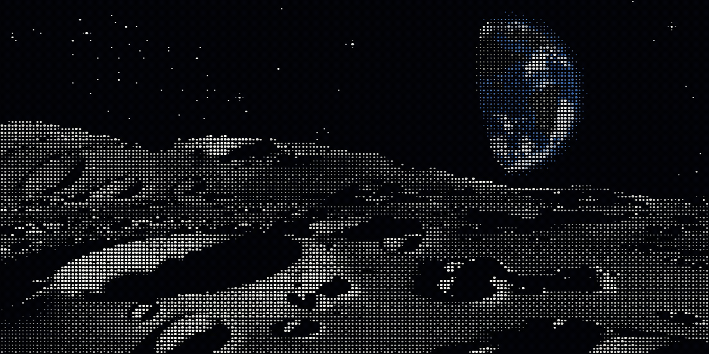

<!-- Banner: the "earthrise" piece from ascii.rest (MIT, @bas3line) — see assets/banner/NOTICE.md.
     To use the original renderer in assets/earthrise/ instead, swap the path below
     for assets/earthrise/earthrise.gif. -->

### Heya there 👋

I'm Shenton (Shentao) Yan — a postgraduate student in Low-Altitude Economics at The Hong Kong Polytechnic University, after an undergraduate degree in Supply Chain Management at Shenzhen University.

I work on operations research and mechanism design, and I keep wandering into blockchain standards and multi-agent AI. I write in both English and Chinese.

<h3 align="center">🔭 Recent projects (auto-updated from GitHub):</h3>

<!-- recent-projects:start -->
- [auction-gan-lab](https://github.com/shentonyan/auction-gan-lab), Recent experiments and development.  updated 2026-11-27
- [bitcoin-flow-monitor](https://github.com/shentonyan/bitcoin-flow-monitor), 一个采用 Apple 风格设计的比特币交易监测仪表盘，能够查询地址并实时展示 UTXO 交易流向。  updated 2026-11-26
- [star-isles](https://github.com/shentonyan/star-isles), A tiny explorable pixel coast and project portfolio — Rust/WebAssembly terrain, twelve stars and a lighthouse; [live demo](https://shentonyan.github.io/star-isles/)  updated 2026-11-26
- [cathay-meal-forecast](https://github.com/shentonyan/cathay-meal-forecast), Recent experiments and development; [live demo](https://shentonyan.github.io/cathay-meal-forecast/)  updated 2026-11-26
- [sunlight-ruler](https://github.com/shentonyan/sunlight-ruler), 一款以当前时间、日出日落与剩余自然光为核心的 Apple 风格交互网页原型，包含城市切换和小组件预览。  updated 2026-11-26
- [dice6-3d](https://github.com/shentonyan/dice6-3d), 一个面向手机操作的黑白极简 3D 骰子投掷网页。  updated 2026-11-26
<!-- recent-projects:end -->

<h3 align="center">🧪 Research threads, not all of them repositories yet:</h3>

- Low-altitude logistics: network design, congestion at landing points, and resilience in megacity drone delivery
- Auction and market design for construction and demolition waste trading in Shenzhen, including a differentiable mechanism-design benchmark
- Multi-agent AI and its governance — I've been reading the Ethereum standards for agent memory, including ERC-8350
- Community co-governance with [NaturalDAO], where I contribute to the PoL2 documents
- Cyber-Physical Internet: a source-traceable literature map of digital–physical integration in logistics

<h3 align="center">🗂️ And a few more:</h3>

- [pol2-governance-compiler], turns PoL2 governance documents into checkable rules ![python]
- [pol2-jev-honesty], honesty probes for typed-decision models ![python]
- [pol2-laya-studio], a workbench for the PoL2 experiments ![python]
- [agent-governance-lab], an auditable harness for experiments on agent governance artifacts ![python]
- [cpi-research-dataset], a source-traceable index of Cyber-Physical Internet research

Older coursework, experiments, and forks are in the [repository list].

---

Banner: <b>earthrise</b> from <a href="https://ascii.rest/earthrise/">ascii.rest</a> by <a href="https://github.com/bas3line">@bas3line</a>, MIT licensed — notice in <a href="assets/banner/NOTICE.md">assets/banner</a>. An independent ASCII earthrise renderer of my own lives in <a href="assets/earthrise/">assets/earthrise</a>.

[sealed-bid-award-erc]:https://github.com/shentonyan/sealed-bid-award-erc
[veil-tender]:https://github.com/shentonyan/veil-tender
[pol2-agent-ballot]:https://github.com/shentonyan/pol2-agent-ballot
[subq-decision-lab]:https://github.com/shentonyan/subq-decision-lab
[autoscientists]:https://github.com/shentonyan/autoscientists
[dao-governance-replication]:https://github.com/shentonyan/dao-governance-replication
[pol2-governance-compiler]:https://github.com/shentonyan/pol2-governance-compiler
[pol2-jev-honesty]:https://github.com/shentonyan/pol2-jev-honesty
[pol2-laya-studio]:https://github.com/shentonyan/pol2-laya-studio
[agent-governance-lab]:https://github.com/shentonyan/agent-governance-lab
[cpi-research-dataset]:https://github.com/shentonyan/cpi-research-dataset
[NaturalDAO]:https://github.com/naturaldao/NaturalDAO
[repository list]:https://github.com/shentonyan?tab=repositories
[shentonyan.github.io]:https://shentonyan.github.io

[python]:https://img.shields.io/badge/Python-161b22?style=flat&logo=python&logoColor=3776ab
[solidity]:https://img.shields.io/badge/Solidity-161b22?style=flat&logo=solidity&logoColor=white
[ethereum]:https://img.shields.io/badge/Ethereum-161b22?style=flat&logo=ethereum&logoColor=8c8cff
[typescript]:https://img.shields.io/badge/TypeScript-161b22?style=flat&logo=typescript&logoColor=3178c6
[lean]:https://img.shields.io/badge/Lean%204-161b22?style=flat&logo=lean&logoColor=white
[latex]:https://img.shields.io/badge/LaTeX-161b22?style=flat&logo=latex&logoColor=008080
